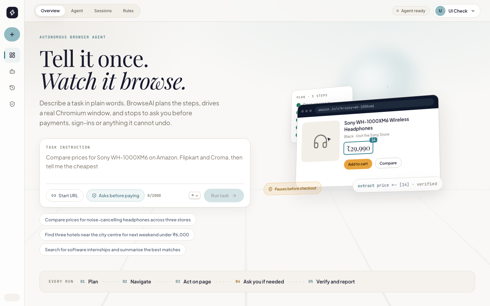
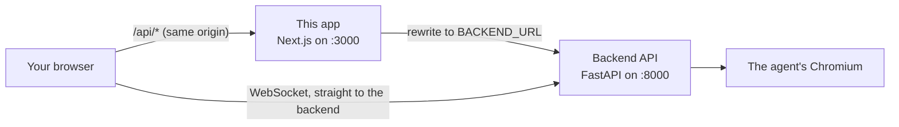

# BrowseAI: frontend

The web interface for the **Browser Automation Agent**. You describe a task in
plain words. The agent plans it, drives a real Chromium window, and this app
shows you every step as it happens: a screenshot of the page, the element the
agent acted on outlined, and the agent's own reasoning for doing it.



It is a Next.js app. All the agent work happens in the
[backend](https://github.com/Abhishek9639/browser-agent-backend), which this app
talks to over REST and a WebSocket. It has nothing to show without it.

> **Student project.** Built for an OJT programme as part of **AI-07**. It is not
> a product and has never been deployed. Read the
> [disclaimer](#disclaimer) before pointing it at a real site.

## Part of three repositories

| Repository | What it is | State |
|---|---|---|
| **Browser-Automation-Agent** | This one. The web interface | Built |
| [browser-agent-backend](https://github.com/Abhishek9639/browser-agent-backend) | The agent, the API, sign-in and task history | Built |
| browser-agent-payments | A credits wallet in Razorpay test mode | Not built yet |

This app only ever talks to the backend, through its public REST API and its
WebSocket stream. It never calls payments directly.

## What you can do

- **Give the agent a task** in plain language, optionally with a start URL so it
  begins on the right site. `Ctrl`/`⌘` + `Enter` runs it.
- **Watch it live.** Each step arrives with a screenshot of the page, with the
  element the agent clicked or typed into outlined and labelled.
- **Replay a run.** Pick any step in the timeline or the filmstrip to see the
  page as it was then. Expand the view to fill the window, step through it with
  the arrow keys, and press `Esc` to close it.
- **Read its reasoning.** Every step carries the agent's explanation, and tags
  for steps that used vision, came from a cached flow, needed recovery, or could
  not be verified. The step list scrolls on its own and follows the newest step,
  but stays where you are if you scroll up to read.
- **Stay in control.** The agent stops and hands the browser back for payments,
  sign-ins and personal details, and asks before anything it cannot undo. Each
  case has its own card, showing the page the decision is about, and a notice
  pops up in the corner so a waiting run is hard to miss.
- **Answer its questions** when it needs a detail you did not give it.
- **Keep track.** Sessions lists every run with its result, refreshes itself
  while anything is still running, and lets you cancel a run that is stuck
  waiting. The overview shows your totals, success rate and median run time.

## How it fits together



REST calls go to `/api/...` on this app's own origin and Next.js forwards them to
the backend. That keeps them same-origin, which is what lets the backend's
refresh cookie work. Next.js does not forward WebSocket upgrades, so the live
stream connects to the backend directly. That is why there are two settings
below.

## Running it locally

### 1. Start the backend

Follow the backend's
[quick start](https://github.com/Abhishek9639/browser-agent-backend#quick-start).
Either `make up` (Docker: Postgres and the API), or
`make dev` if you already run Postgres yourself. Then check it answers:

```bash
curl http://127.0.0.1:8000/api/v1/health
```

You want `"status":"ok"` and `"db":"ok"`.

### 2. Point this app at it

```bash
cp .env.example .env.local
```

The defaults assume the backend is on `127.0.0.1:8000`. Edit `.env.local` only
if yours is somewhere else.

### 3. Install and start

```bash
npm install
```

```bash
npm run dev
```

Open <http://localhost:3000>. If port 3000 is taken, run `npm run dev -- -p 3001`
instead.

### 4. Sign in and run a task

**Sign in** has a Register tab that creates the account on your backend.
Passwords must be at least 10 characters and not only digits. That is the
backend's rule, and the form checks it before sending.

## Choosing which sites the agent can use

The backend only lets the agent visit the sites on its `AGENT_ALLOWED_DOMAINS`
list, and by default that is this machine alone. Add the sites you want to use,
comma-separated, in the backend's `.env`, or set it to `*` while you run it
yourself, then restart the backend.

To start a run on a particular page, open **Start URL** in the task box and
paste the address. Without one the agent starts on a blank page and finds its
own way.

## Configuration

Both settings live in `.env.local`, which git ignores. `.env.example` has them
with comments.

| Variable | Default | What it does |
|---|---|---|
| `BACKEND_URL` | `http://127.0.0.1:8000` | Where Next.js forwards `/api/*`. Read by the server, never sent to the browser |
| `NEXT_PUBLIC_BACKEND_WS_URL` | `ws://localhost:8000` | Where the browser opens the live stream. Built into the client bundle, so never put a secret in it |

Restart `npm run dev` after changing either of them.

For a production build, set both **before** `npm run build`. The build writes
`BACKEND_URL` into its routing table and `NEXT_PUBLIC_BACKEND_WS_URL` into the
client code, so changing them on the server afterwards does nothing until you
build again. On an HTTPS site the WebSocket URL has to be `wss://`, or the
browser blocks it.

## Scripts

| Command | What it does |
|---|---|
| `npm run dev` | Development server with hot reload |
| `npm run build` | Production build |
| `npm run start` | Serve the production build |
| `npm run lint` | ESLint |

## Troubleshooting

| What you see | Why, and what to do |
|---|---|
| `401` errors in the console before you sign in | Expected. On load the app tries to restore a session from the refresh cookie, and without one the backend says no |
| "Lost the live connection" | The browser could not reach `NEXT_PUBLIC_BACKEND_WS_URL`. Check the backend is up and the variable points at it. The task may still be running; Sessions shows where it got to |
| A run stops with a message about an allowed domain | The backend's `AGENT_ALLOWED_DOMAINS` does not include that site |
| A setting change has no effect | Restart `npm run dev`. Environment variables are read when it starts |

## How the live view works

Every `step` event from the backend carries a base64 JPEG of the page, the `bbox`
of the element the agent acted on, and the `viewport` those coordinates are in.
`LiveBrowser.jsx` sizes the stage to that viewport's aspect ratio and places the
box over the screenshot as a percentage of it, so the outline lands on the right
element at any window size. `approval_required` carries the same pair, which is
why a pending approval takes over the view: you should see what you are being
asked to approve.

The backend's [docs/api.md](https://github.com/Abhishek9639/browser-agent-backend/blob/main/docs/api.md)
is the authoritative contract for those events. If a field here looks wrong,
check it there first.

## Project layout

```text
src/app/
  layout.jsx               fonts, metadata, the auth provider
  page.jsx                 the app shell and all run state, fed by the stream
  globals.css              the whole theme and every component's styles
  lib/
    api.js                 REST calls, token refresh, the WebSocket
    auth-context.js        who is signed in
  components/
    HeroSection.jsx        the home screen and its 3D illustration
    PromptInput.jsx        the task box and start URL
    LiveBrowser.jsx        the agent's view, outline, filmstrip, expand
    ExecutionTimeline.jsx  the plan and the steps taken
    AIThinking.jsx         the agent's reasoning and its current phase
    ApprovalCard.jsx       payment, sign-in and details hand-offs
    QuestionCard.jsx       a question the agent cannot answer itself
    RightPanel.jsx         tool calls, page facts, run stats
    RecentSessions.jsx     the sessions list, with cancel
    StatsCards.jsx         totals and success rate
    Sidebar.jsx, TopNav.jsx, AuthModal.jsx, Toasts.jsx, Reveal.jsx, Scene3D.jsx
docs/images/               the screenshots in this README
```

## Built with

- [Next.js](https://nextjs.org) 16 with the React Compiler, and React 19
- [Framer Motion](https://motion.dev) for animation, [Lucide](https://lucide.dev) for icons
- Plain CSS in `globals.css`, with the 3D background made from CSS transforms
  rather than WebGL
- Playfair Display, Plus Jakarta Sans and JetBrains Mono, loaded through `next/font`

## Before you push

```bash
npm run lint
```

```bash
npm run build
```

Both should pass. For a UI change, also run a task and check it in the browser:
the build passing does not mean the page looks right.

## Disclaimer

This is a student project, not a product. In short:

- **Not for real transactions.** The agent stops before payments and hands the
  browser to you, but it can be wrong, and the approval step is the only thing
  between a mistake and a purchase.
- **Only sites that permit automation.** The backend only lets the agent visit
  the sites on its allow-list. Add only sites whose terms allow automation.
- **No real personal data.** Do not type real cards, passwords or other
  people's details into a run.

The full disclaimer is in the
[backend README](https://github.com/Abhishek9639/browser-agent-backend#disclaimer).
